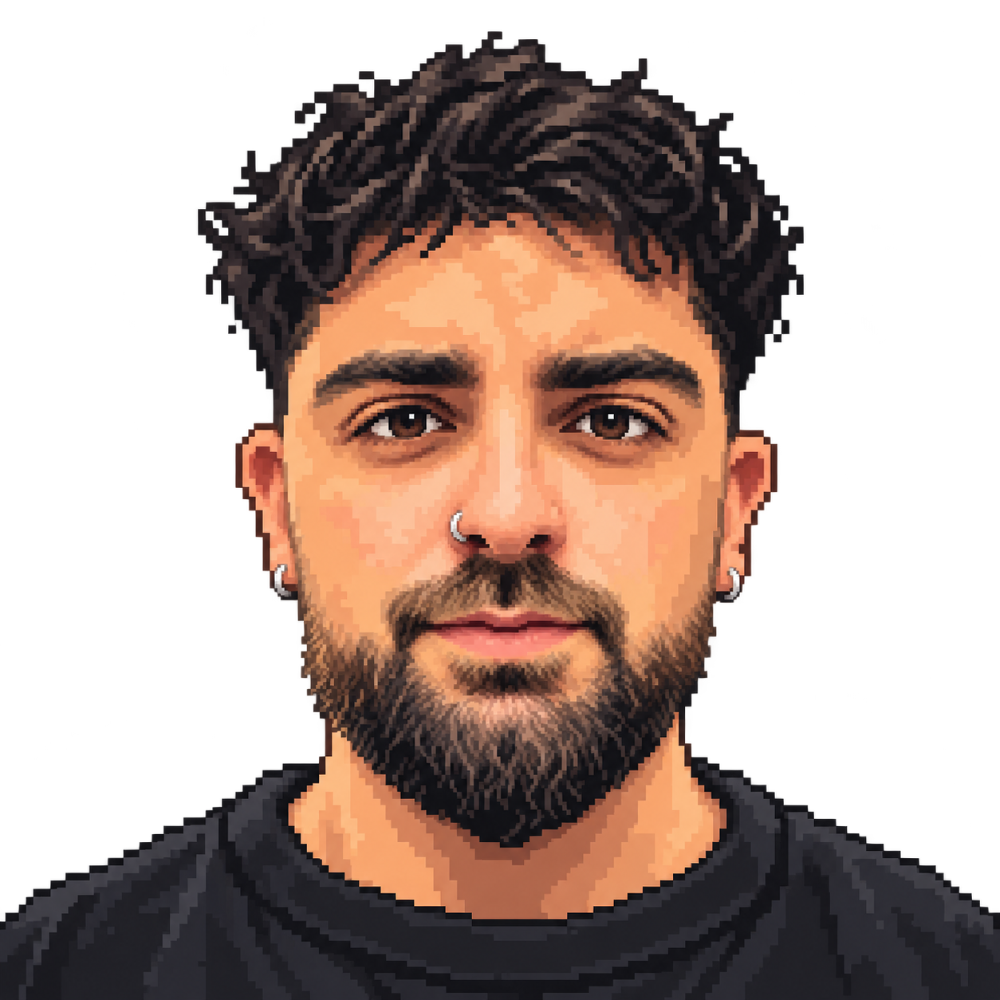

# José Luis Caballero

**Front-end & mobile developer · Web designer** 
Cádiz, Spain

I build websites and apps with React, Next.js and React Native. At **[Wdtech](https://www.wdtech.io/es)**, I work on IoT interfaces and mobile applications. In my own projects, I explore 3D, motion and playful ways to interact with the web.

[Portfolio](https://www.joseluisdev.es/en) · [CV](https://www.joseluisdev.es/en/cv) · [LinkedIn](https://www.linkedin.com/in/joseluiscaballerodev) · [Email](mailto:joseluiscaballerodev@gmail.com)

### Selected work

**[Paulitaadiaz](https://paulitadiaz.vercel.app)** 
An interactive 3D room for a Valorant streamer, with seasonal decorations, her dog Ecco and a live cork board for her community. Design and development.

`Next.js` `TypeScript` `Three.js` `Redis` 
[Explore the room](https://paulitadiaz.vercel.app) · [Read the case study](https://www.joseluisdev.es/en/project/paulitaadiaz)

**[My portfolio](https://www.joseluisdev.es/en)** 
A playable handheld console with project cartridges, pixel art and minigames. Switch to the CV view for my work and experience.

`Next.js` `React` `TypeScript` `Three.js` 
[Try the console](https://www.joseluisdev.es/en) · [Browse my work](https://www.joseluisdev.es/en/cv)

**[Helementa & Helementa App](https://www.joseluisdev.es/en/project/helementa)** 
IoT monitoring on the web and on mobile: device management, real-time data and alerts. My work at Wdtech covers the front-end and the mobile app.

`Next.js` `TypeScript` `React Native` `Expo` 
[Web case study](https://www.joseluisdev.es/en/project/helementa) · [Mobile case study](https://www.joseluisdev.es/en/project/helementa-mobile) · [App Store](https://apps.apple.com/es/app/helementa/id6746443993)

### What I work with

  &nbsp;&nbsp;
  &nbsp;&nbsp;
  &nbsp;&nbsp;
  <picture>
    <source media="(prefers-color-scheme: dark)" srcset="./assets/tech/expo-dark.svg" />
    
  </picture>&nbsp;&nbsp;
  <picture>
    <source media="(prefers-color-scheme: dark)" srcset="./assets/tech/threejs-dark.svg" />
    
  </picture>&nbsp;&nbsp;
  

- **Web:** React, Next.js, TypeScript, Tailwind CSS.
- **Mobile:** React Native, Expo, NativeWind.
- **Design & interaction:** Figma, Three.js, GSAP, Motion.

### Away from the screen

Boxing, padel and time with my family. I got into programming because I enjoy creating and designing things that surprise people.

---

**Have something in mind?** [Send me an email](mailto:joseluiscaballerodev@gmail.com) or [say hello on Telegram](https://t.me/joseluiscaballerow).
