<a href="https://www.joseluisdev.es/en">
  <picture>
    <source media="(max-width: 600px)" srcset="./assets/profile/header-mobile.svg" />
    
  </picture>
</a>

  <a href="https://www.joseluisdev.es/en">Portfolio</a> &nbsp;·&nbsp;
  <a href="https://www.joseluisdev.es/en/cv">CV</a> &nbsp;·&nbsp;
  <a href="https://www.linkedin.com/in/joseluiscaballerodev">LinkedIn</a> &nbsp;·&nbsp;
  <a href="mailto:joseluiscaballerodev@gmail.com">Email</a>

I build web and mobile interfaces at **[Wdtech](https://www.wdtech.io/es)**. Outside work, I make interactive websites with 3D, motion and a playful side. These are a few of them.

<a href="https://www.joseluisdev.es/en">
  <picture>
    <source media="(max-width: 600px)" srcset="./assets/profile/portfolio-mobile.svg" />
    
  </picture>
</a>

<a href="https://paulitadiaz.vercel.app">
  <picture>
    <source media="(max-width: 600px)" srcset="./assets/profile/paulitaadiaz-mobile.svg" />
    
  </picture>
</a>

<a href="https://www.joseluisdev.es/en/project/helementa">
  <picture>
    <source media="(max-width: 600px)" srcset="./assets/profile/helementa-mobile.svg" />
    
  </picture>
</a>

[More work & case studies](https://www.joseluisdev.es/en/cv)

### My everyday tools

  &nbsp;&nbsp;
  &nbsp;&nbsp;
  &nbsp;&nbsp;
  <picture>
    <source media="(prefers-color-scheme: dark)" srcset="./assets/tech/expo-dark.svg" />
    
  </picture>&nbsp;&nbsp;
  <picture>
    <source media="(prefers-color-scheme: dark)" srcset="./assets/tech/threejs-dark.svg" />
    
  </picture>&nbsp;&nbsp;
  

React & Next.js for the web. React Native & Expo for mobile. Figma, Three.js, GSAP and Motion for the details that make an interface feel right.

### Away from the screen

Boxing, padel and time with my family. I started programming because I enjoy creating things and seeing people react to them. That is still my favourite part.

---

**Have something in mind?** [Send me an email](mailto:joseluiscaballerodev@gmail.com) or [say hello on Telegram](https://t.me/joseluiscaballerow).
