<!-- Generated by scripts/build_profile.py. Edit copy in scripts/profile_content.py. -->

<a href="https://www.joseluisdev.es/en">
  <picture>
    <source media="(max-width: 600px)" srcset="./assets/profile/header-mobile.svg" />
    
  </picture>
</a>

<picture>
    <source media="(max-width: 600px)" srcset="./assets/profile/work-mobile.svg" />
    
  </picture>

<a href="https://www.joseluisdev.es/en/project/paulitaadiaz">
  <picture>
    <source media="(max-width: 600px)" srcset="./assets/profile/paulitaadiaz-mobile.svg" />
    
  </picture>
</a>

<a href="https://www.joseluisdev.es/en/project/helementa">
  <picture>
    <source media="(max-width: 600px)" srcset="./assets/profile/helementa-mobile.svg" />
    
  </picture>
</a>

<a href="https://www.joseluisdev.es/en/project/helementa-mobile">
  <picture>
    <source media="(max-width: 600px)" srcset="./assets/profile/helementa-app-mobile.svg" />
    
  </picture>
</a>

<a href="https://www.joseluisdev.es/en/project/wdtech">
  <picture>
    <source media="(max-width: 600px)" srcset="./assets/profile/wdtech-mobile.svg" />
    
  </picture>
</a>

<picture>
    <source media="(max-width: 600px)" srcset="./assets/profile/more-mobile.svg" />
    
  </picture>

<a href="https://www.joseluisdev.es/en/project/nexum">
  <picture>
    <source media="(max-width: 600px)" srcset="./assets/profile/more-04-mobile.svg" />
    
  </picture>
</a>

<a href="https://www.joseluisdev.es/en/project/santipatico">
  <picture>
    <source media="(max-width: 600px)" srcset="./assets/profile/more-06-mobile.svg" />
    
  </picture>
</a>

<a href="https://www.joseluisdev.es/en/project/enasun">
  <picture>
    <source media="(max-width: 600px)" srcset="./assets/profile/more-07-mobile.svg" />
    
  </picture>
</a>

<a href="https://www.joseluisdev.es/en/project/abyss-rp">
  <picture>
    <source media="(max-width: 600px)" srcset="./assets/profile/more-08-mobile.svg" />
    
  </picture>
</a>

<a href="https://www.joseluisdev.es/en/cv">
  <picture>
    <source media="(max-width: 600px)" srcset="./assets/profile/experience-mobile.svg" />
    
  </picture>
</a>

<picture>
    <source media="(max-width: 600px)" srcset="./assets/profile/toolkit-mobile.svg" />
    
  </picture>

<picture>
    <source media="(max-width: 600px)" srcset="./assets/profile/about-mobile.svg" />
    
  </picture>

<picture>
    <source media="(max-width: 600px)" srcset="./assets/profile/contact-mobile.svg" />
    
  </picture>

<a href="mailto:joseluiscaballerodev@gmail.com">
  <picture>
    <source media="(max-width: 600px)" srcset="./assets/profile/contact-email-mobile.svg" />
    
  </picture>
</a>

<a href="https://www.linkedin.com/in/joseluiscaballerodev">
  <picture>
    <source media="(max-width: 600px)" srcset="./assets/profile/contact-linkedin-mobile.svg" />
    
  </picture>
</a>

<a href="https://t.me/joseluiscaballerow">
  <picture>
    <source media="(max-width: 600px)" srcset="./assets/profile/contact-telegram-mobile.svg" />
    
  </picture>
</a>

<a href="https://www.joseluisdev.es/en/cv">
  <picture>
    <source media="(max-width: 600px)" srcset="./assets/profile/contact-cv-mobile.svg" />
    
  </picture>
</a>

<a href="./PROFILE.md">
  <picture>
    <source media="(max-width: 600px)" srcset="./assets/profile/footer-mobile.svg" />
    
  </picture>
</a>
